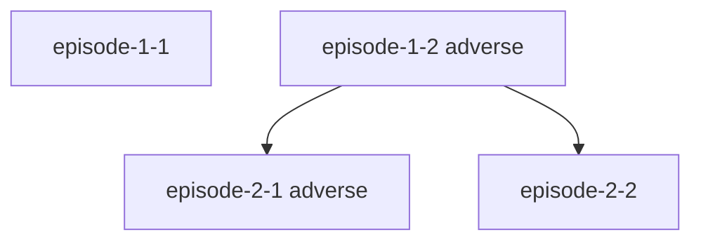

# 假设树与实测结果标注

## Episode 1（status=completed）

- **   episode-1-1**  score=7.5
  - claim: In E-MTAB-8316, the magnitude of the prespecified UNC106238 transcript response is larger in macrophage-prese…
- **⭐ episode-1-2**  score=8.0
  - claim: In E-MTAB-8316, a subset of prespecified UNC106238-responsive transcripts shows opposite-direction responses …
  - **exec outcome: adverse**

## Episode 2（status=completed）

- **⭐ episode-2-1  ^ parents=['episode-1-2']**  score=8.0
  - claim: In E-MTAB-8316, the UNC106238 response (UNC vs none) has a macrophage-context-dependent component: among the …
  - **exec outcome: adverse**
- **   episode-2-2  ^ parents=['episode-1-2']**  score=7.5
  - claim: In E-MTAB-8316, the magnitude of the UNC106238 response is monotonically associated with continuous macrophag…

## Mermaid（可渲染树）

